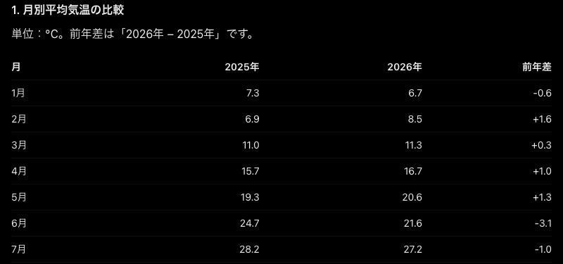
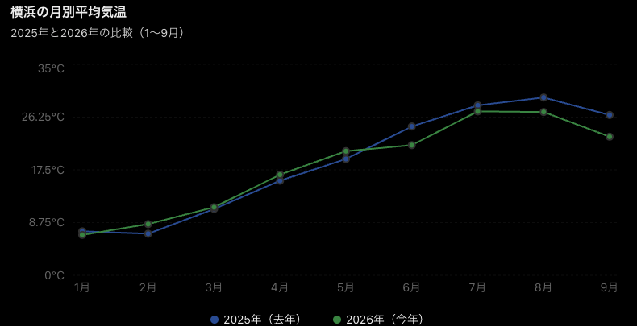
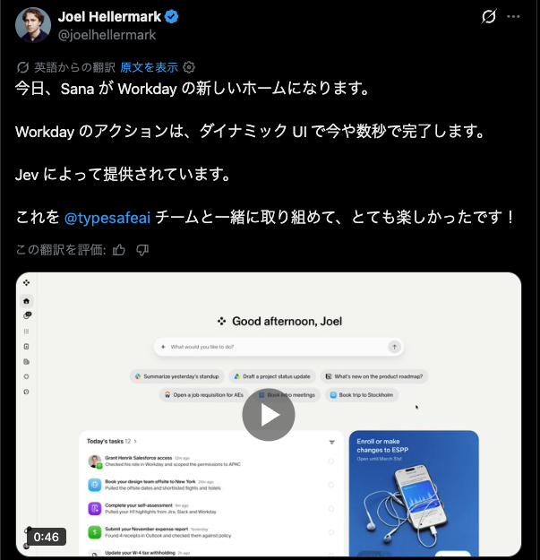

<div class="hero">
  <div class="eyebrow">Jev活用の最前線〜実践事例から学ぶ、Jevの強み・課題と活用ノウハウ〜</div>
  <h1 class="title">Jev で実現する Generative UI</h1>
  <div class="mono muted">azukiazusa</div>
</div>

<!--
「Jev で実現する Generative UI」というタイトルでお話しします。
Jev のことはご存じの方が多いと思うので、今日は Jev そのものより、Generative UI という使い道の話をします。
-->

---

## 自己紹介

<div class="columns">

<div class="card">

- **azukiazusa**
- Frontend Engineer
- https://azukiazusa.dev
- 週に 1 回、Web 開発と AI の記事を書いています
- FE（フロントエンド | ファイアーエムブレム）が好き

</div>

<div class="center">


</div>

</div>

<!--
簡単に自己紹介です。
azukiazusa という名前で活動していて、フロントエンド中心に情報発信をしています。
Jev についても、実際に試した記事をいくつか書いています。
-->

---

## 今日のゴール

- **Generative UI** とは何か
- なぜ **Jev** と相性がいいのか

<!--
今日のゴールは 2 つです。Generative UI とは何かを知ること、そしてなぜ Jev と相性がいいのかを理解することです。
まずは Generative UI とは何かを見ていきましょう
（ここまでで 1 分）
-->

---

<div class="hero">
  <div class="huge">AI は文章だけでなく<br /><span class="accent">UI</span> を返すようになった</div>
</div>

<!--
一昔前の AI と比べて、最近の AI は、文章だけでなく UI を返すようになってきました。
-->

---

## 数字の羅列より、グラフのほうが理解しやすい

<div class="columns">

<div>
<div class="label">Text</div>

</div>

<div>
<div class="label">UI</div>

</div>

</div>

<div class="small muted">ChatGPT に横浜の今年と去年の気温の推移を質問した回答</div>

<!--
AI が出力した文章をそのまま読むより、UI として出してもらったほうが理解しやすい場面があるためです。
ChatGPT に、横浜の今年と去年の気温の推移を聞いてみました。左は UI を使わず文字だけで答えるように指示した回答で、右は指示なしの回答です。
この例のように、グラフのほうが比較がしやすいということは一目瞭然であると思います。
-->

---

## Claude も ChatGPT も、回答を UI で返し始めた

<div class="compare">

<div class="side">
  <div class="label">2026.03</div>
  <h3>Claude</h3>

- 会話の中にチャートや図を表示
- 必要と判断すれば自ら作成

</div>

<div class="side">
  <div class="label">2026.10</div>
  <h3>ChatGPT</h3>

- Intelligent UI
- グラフ、フォーム、小さなツールを回答に表示

</div>

</div>

<!--
この流れは主要な AI チャットにも広がっています。
Claude は 2026 年 3 月に、会話の中にインタラクティブなチャートや図を表示する機能を公開しました。
ChatGPT も 2026 年 10 月に Intelligent UI を発表し、回答の中にグラフやフォームなどを表示できるようになりました。
このように、AI の回答に UI を組み込むことが一般的になってきています。
-->

---

<div class="hero">
  <div class="lead">Generative UI とは？</div>
  <div class="huge">AI が文脈に応じて<br /><span class="accent">UI を返す</span>こと</div>
</div>

<!--
では、Generative UI とは何でしょうか。
ここでは広く、AI が文脈に応じて UI を返すこと、と定義しておきます。ここまで見てきた Claude や ChatGPT の機能も Generative UI です。
-->

---


<div class="hero">
  <div class="huge">プロダクトに組み込むときの課題</div>
</div>

<!-- Generative UI は魅力的な機能ですが、プロダクトに組み込むときには課題があります。
-->

---

## 生成された UI を、どうプロダクトの品質に合わせるか？

- 見た目を既存のデザインシステムに揃えたい
- 存在しないコンポーネントや Props を防ぎたい
- 表示するだけでなく、振る舞いも制御したい
<!--
プロダクトに組み込むときの課題は、生成された UI をどうプロダクトの品質に合わせるかです。AI に自由に UI を作らせると、見た目が既存のデザインシステムと揃わなかったり、存在しないコンポーネントや Props が出てきたりする可能性があります。
また、表示するだけでなく、振る舞いも制御したい場合があります。例えば、ボタンを押したときにどのような処理をするかを決めたい場合です。
-->

---

## デザインシステムのコンポーネントを返す

<div class="flow">
  <div class="card"><div class="label">Design System</div>コンポーネント</div>
  <div class="arrow">→</div>
  <div class="card"><div class="label">AI</div>画面を組み立てる</div>
  <div class="arrow">→</div>
  <div class="card"><div class="label">Product</div>いつもの画面が AI により出力される</div>
</div>

json-render や A2UI といった Generative UI のライブラリは、デザインシステムのコンポーネントを返すことを前提に作られている

<!--
そこで大事になるのが、AI にゼロから UI を作らせず、デザインシステムにあるコンポーネントを返させることです。
AI は用意されたコンポーネントだけを使用して UI を組み立てるので、デザイン上の品質を担保できます。
json-render や A2UI といた Generative UI のライブラリは、まさにこの考え方で作られています。
-->

---

## これまでは LLM に*ルール*を渡して生成させてきた

- コンポーネントの定義からプロンプトを作る
- 出力形式のルールも一緒に渡す
- LLM はルールに沿って UI を表す文字列を生成する
- アプリ側で検証して描画する

<div class="small muted">例: json-render は JSON Patch、OpenUI は OpenUI Lang を出力する</div>

<!--
では、デザインシステムのコンポーネントをどうやって返させるのでしょうか。これまでの主な方法は、LLM にルールを渡して生成させることでした。
コンポーネントの定義からプロンプトを作り、出力形式のルールと一緒に LLM に渡します。LLM はルールに沿って UI を表す文字列を生成し、アプリ側で検証して描画します。
例えば json-render は JSON Patch、OpenUI は独自の OpenUI Lang といった形式を出力します。
-->

---


## 出力形式やルールをプロンプトで渡す

```ts
const catalog = new Catalog({ /* コンポーネントを定義 */ });

const result = streamText({
  model: "openai/gpt-4.1-mini",
  system: catalog.prompt(),
  prompt: buildUserPrompt({ prompt }),
});

return result.toTextStreamResponse();
```

- `catalog.prompt()` にコンポーネントの定義と出力形式の指示が入る
- JSON を書いてもらうには、形式の説明が必要

<!--
実際のコード例も見てみましょう。まず、従来の LLM と json-render を組み合わせたサンプルです。
注目してほしいのは system の部分です。catalog.prompt() がシステムプロンプトを生成しています。このカタログというのが、デザインシステムのコンポーネントを定義したもので、これにより事前に定義されたコンポーネントだけを使うように LLM に指示できます。
またその他にも、出力形式の指示や、JSON を書いてもらうための形式の説明などが含まれています。
-->

---

## プロンプトの一例

```text
OUTPUT FORMAT (JSONL, RFC 6902 JSON Patch):
Output JSONL (one JSON object per line) ...

RULES:
1. Output ONLY JSONL patches - ... no markdown, no code fences
5. ONLY use components listed above
14. CRITICAL: The "on" field goes on the ELEMENT object, NOT inside "props".
```

- コンポーネントの説明は数行で、大半は出力形式や記法のルール

<!--
実際にどのようなプロンプトが渡されるかの例です。
プロンプトのうち、コンポーネントの説明はそのうち数行だけで、大半は出力形式や記法のルールです。「マークダウンで囲まないで」「上で定義されていないコンポーネントは使わないで」と、いった指示が並んでいます。
このように出力形式を担保するために長大なプロンプトを渡す必要がある上に、LLM の変化により出力が変わる可能性があるという点も考慮に入れる必要があります。
-->

---

<div class="hero">
  <div class="huge">Jev を使用したアプローチ</div>
</div>

<!--
ここで解決策となるのが、Jev を使用したアプローチです。Jev は、LLM に生成させるのではなく、候補の中から選ばせることに特化したモデルです。
-->

---

## UI の組み立てを、Jev の「選択」で実現する

- コンポーネントの候補をアプリ側で用意する
- Jev は候補の中から必要なコンポーネントと配置を選ぶ
- json-render は Jev の選択結果から UI を構成する

<div class="mt-2">
コンポーネントを生成させるのではなく、候補の中から選ばせることで、出力形式やルールをプロンプトで渡す必要がなくなる
</div>

<!--
コンポーネントの候補が決まっているなら、UI の組み立てを選択の問題として扱えます。
ルールに従ってコンポーネントを都度生成させるのではなく、候補の中から選ばせることで、出力形式やルールをプロンプトで渡す必要がなくなります。また、Jev が素早く応答を返す・コストが安いといったメリットもあります。
Generative UI のライブラリは、Jev の選択結果から UI を構成することができます。
-->

---

## Jev では Props まで候補として用意する

- LLM に生成させていた Props の値を、あらかじめ候補に設定する
  - 従来のアプローチ: Input コンポーネントのラベルを都度生成
  - Jev: Input コンポーネントのラベルを候補として先に用意する
    - 「メールアドレス」「電話番号」...

 <div class="mt-2">
  Props の値を動的に決めることはできないので、用途の決まった UI を用意する必要がある
</div>
<!--
Jev では Props の候補までアプリ側で用意する必要があるという大きな違いがあります。例えば入力フォームで「メールアドレス」と「電話番号」のラベルをもつ Input コンポーネントを用意する場合、従来の LLM では「メールアドレス」と「電話番号」のラベルを AI が決めていましたが、Jev ではアプリ側で決めておく必要があります。
Jev は、候補の採用・順序・配置を選ぶことに特化しているので、Props の値を動的に決めると言ったことができないわけですね。
-->

---


## コンポーネントの候補を用意する

```ts
const nameCandidate = {
  id: "name",
  description: 'Editable name, label "名前", bound to /name',
  root: false,
  element: {
    type: "Input",
    props: {
      label: "名前",
      type: "text",
      value: { $bindState: "/name" },
    },
  },
} satisfies Experimental_CompositionCandidate;
```

<!--
一方、Jev を json-rener で使う例を見てみましょう。どのコンポーネントを、どんなラベルで、どの状態に結び付けるかまで、アプリケーション側で決めておきます。Jev には候補を渡すだけで、どのコンポーネントを使うかは Jev が選んでくれます。
従来の LLM でどんなラベルをつけるかまで AI が決めていたのに対して、Jev ではラベルもアプリ側で決めておくというのが大きな違いです。
-->

---

## Jev の選択を元に UI を組み立てる

```ts
const evaluate = async ({ state, questions, signal }) => {
  const { answers } = await client.systemOne(
    { model: "jev-latest", state, questions },
    { signal },
  );
  return { answers };
};

for await (const event of experimental_composeSpec({
  catalog, candidates, initialState, prompt, evaluate,
})) {
  if (event.spec) updatePreview(event.spec);
}
```

<!--
呼び出す側のコードです。experimental_composeSpec に候補と評価関数を渡すと、Jev の判断をもとに Spec を組み立ててくれます。
Jev で返ってきた結果は構造化されているので、アプリ側で検証して updatePreview に渡すだけで、画面を描画できます。
-->

---

## Jev と GPT-4.1 mini の比較

<div class="center">
<video src="images/demo-side-by-side.mp4" poster="images/demo-side-by-side.png" height="500" controls muted></video>
</div>

<!--
実際に同じ入力で比べてみましょう。社内アシスタントを題材に、左が GPT-4.1 mini と json-render、右が Jev と json-render を使用しています。
-->

---

## 事例: Workday の Sana は Jev で UI を組み立てる

<div class="columns">

<div>

- 依頼に合わせて UI が変わる
- フォームやカレンダーを表示
- デザインシステムの全コンポーネントを Jev に渡す

</div>

<div class="center">

</div>

</div>

<div class="small muted">https://x.com/joelhellermark/status/2110016092366078265</div>

<!--
実際のプロダクトでの事例も 1 つ紹介します。Workday の AI アシスタント Sana です。
X の投稿では、Sana のダイナミックな UI は Jev で動いていると紹介しています。
Sana は Jev を使い、ユーザーの依頼に合わせてフォームやカレンダーなどの画面を表示しているようです。
これを紹介したブログ記事によると、デザインシステムの全コンポーネントを Jev に渡しているそうです。
-->

---

## まとめ

1. AI の回答は、文章より **UI** のほうが伝わる場面がある
2. プロダクトでは **デザインシステムのコンポーネント** を返す
3. コンポーネントから選ぶ Generative UI は、選択に特化した **Jev** と相性がいい

<!--
まとめです。
1 つ目。AI の回答は、文章より UI のほうが伝わる場面があります。これが Generative UI の出発点です。
2 つ目。プロダクトに組み込むなら、デザインシステムのコンポーネントを返すことが肝要です。
3 つ目。コンポーネントから選ぶ Generative UI は、生成ではなく選択で済むので、選択に特化した Jev と相性がいいです。
-->

---

## 参考

<div class="fit">

- Claude: https://claude.com/blog/claude-builds-visuals
- Intelligent UI: https://techcrunch.com/2026/10/07/chatgpt-is-getting-a-lot-more-visual-with-the-launch-of-a-new-interface/
- Workday: [Sana Is the New Workday Home](https://newsroom.workday.com/2026-10-13-Sana-Is-the-New-Workday-Home-A-Dynamic-Agentic-Experience-Built-to-Finish-the-Work,-Not-Just-Answer-Questions)
- The New Stack: https://thenewstack.io/workday-is-using-typesafes-jev-to-build-user-interfaces-on-the-fly/
- json-render: https://json-render.dev/docs/jev
- Jev: https://docs.typesafe.ai/introduction
- json-render と Jev の解説記事: https://azukiazusa.dev/blog/json-render-jev

</div>

<!--
参考リンクです。発表中は読み上げず、そのまま次に進みます。
-->
